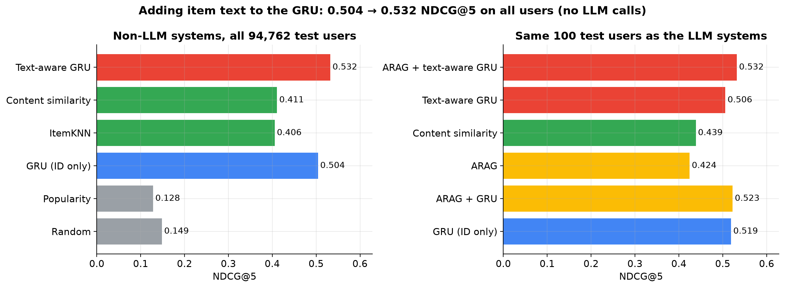
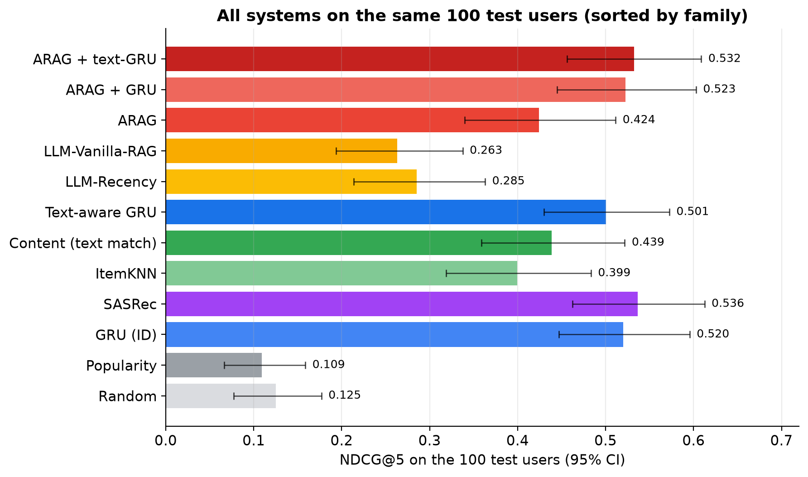
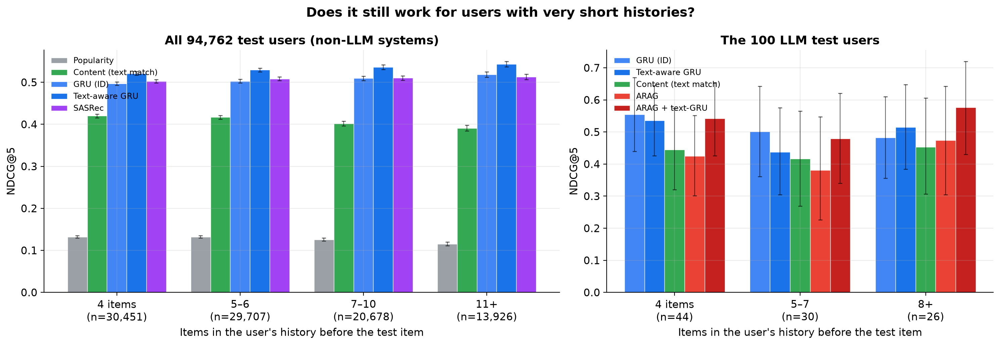
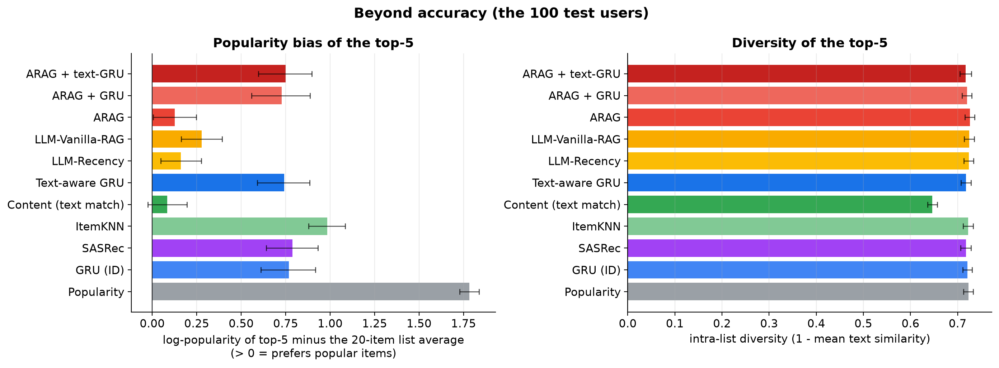

# ARAG + GRU
## Extending an Agentic LLM Recommender with a Trained GRU Sequential Model — Full Project Report

**Course deliverable — reproducibility-first report**

Companion documents: `SPEC.md` (specification & recorded deviations), `docs/PROCESS.md` (step-by-step engineering log with every real number), `results/report.md` (auto-generated results summary).

> **Errata notice.** An earlier version of this report presented results from a run whose
> candidate lists were degenerate (negatives drawn from the whole catalogue, ~81% of which
> have zero interactions), which artefactually inflated every popularity-like system and
> produced a false "H1 supported" conclusion. That flaw was found in review, the lists were
> rebuilt, every system was re-evaluated, the GRU was retrained, and this document was
> rewritten. The original numbers are preserved — not deleted — in **Appendix E**.

> **Final-run notice (§15, Appendix G) — read this first.** The original GRU had a
> weight-initialisation bug (default N(0, 1) item embeddings with a tied output layer), which
> stalled training and made it look weak (NDCG@5 0.279). It was found while adding a SASRec
> baseline, fixed, and both GRUs were retrained; the whole evaluation was re-run from the LLM
> cache at **$0**. With the fixed GRU (0.505 on all users) **H1 is supported** (+0.098, significant)
> and **H2 is not** (+0.004, n.s.) — the reverse of §§6–7 and §12. Trained sequence models
> (GRU, SASRec, text-aware GRU) are more accurate than ARAG on this data; the paper's claims
> versus LLM baselines still reproduce. **§15 has the final numbers;** §§1–14 are kept as the
> record of the study as first run, and their GRU-dependent numbers are superseded.

> **Extension notice (§14).** After the main study, the GRU's weakness was traced to thin ID
> sequences (median 4 training items per user). A **text-aware GRU** (ID embedding + projected
> MiniLM item embedding) and two cheap baselines (content similarity, ItemKNN) were added and
> evaluated **with zero new LLM calls** (all LLM outputs replayed from cache). The text-aware GRU
> raises the trained model from NDCG@5 **0.279 → 0.461** on all 94,762 test users and is
> numerically above ARAG on the 100-user sample (0.462 vs 0.424, n.s.). Sections 1–13 describe
> the original study and are unchanged; §14 reports the extension.

---

## Abstract

This project implements an **ARAG-style agentic recommender** (Maragheh et al., 2025, arXiv:2506.21931) on the Amazon Reviews 2023 **Video Games** category and extends it with **one trained deep-learning component: a PyTorch GRU sequential user model late-fused into the final LLM ranking**. All systems rank the *same frozen 20-item candidate lists* (1 held-out target + 19 **popularity-matched** negatives drawn from the training vocabulary) per user, so the comparison isolates **ranking** from retrieval and no system can win by exploiting an information asymmetry.

Using OpenAI `gpt-4o-mini` for the agent pipeline, 100 sampled test users for every system (plus all 94,762 test users for the non-LLM systems), and the **final run with the fixed GRU (§15)**, we find:

- **H1 supported:** fusing the trained GRU into ARAG significantly improves ARAG (ΔNDCG@5 = **+0.098**, 95% CI [+0.013, +0.182]) at the validation-optimal **α\* = 0.2** (mostly GRU).
- **H2 not supported:** the fused system is no better than the GRU alone (ΔNDCG@5 = **+0.004**, [−0.038, +0.045]).
- **The paper's claims reproduce.** ARAG significantly beats LLM-Recency (+0.139) and LLM-Vanilla-RAG (+0.162), and removing NLI **and** CSA significantly hurts (−0.062).
- **Trained sequence models beat ARAG on accuracy** — a comparison the paper did not make. On the same 100 users: SASRec 0.536, ARAG + text-GRU 0.532, GRU 0.520, text-GRU 0.501 vs ARAG 0.424 (ARAG vs SASRec −0.112, significant; vs GRU −0.095, borderline). On all users the text-aware GRU is best (0.530 vs GRU 0.505, SASRec 0.508).
- **ARAG's advantages are elsewhere:** the lowest popularity bias of any learned system (popularity lift 0.13 vs ~0.77) and the highest coverage, plus natural-language explanations.
- **A pure popularity baseline is at or below random** (NDCG@5 0.109 vs random 0.125): popularity carries no free signal under this protocol.
- **Two of our own mistakes were found and fixed** — degenerate candidate lists (Appendix E) and the GRU initialisation bug (Appendix G); both are documented with the superseded numbers kept.

All numbers are produced by a deterministic, audited pipeline: **`make verify` re-derives every reported metric from the raw per-user predictions and checks dataset hashes and the run record — it passes on the committed artifacts.** The corrected evaluation added **2,263 LLM calls ≈ $1.06** (total unique project spend across both protocol versions: **$2.04**); a re-run from cache is **free (137 s)**.

---

## 0. How to read this document (orientation, glossary, diagram)

**If you have 30 seconds:** the project asks whether adding a *trained* neural sequence model (GRU) to an *LLM agent* recommender (ARAG) improves ranking. Answer: **no (H1 fails) — and on fair candidate lists the LLM agent is itself the best system**, significantly beating the trained model, the paper's simpler LLM baselines, popularity and random ranking.

**If you have 10 minutes:** read §1 (questions), §3.2 (frozen candidate lists — including why they were rebuilt after review), §4 (system), §6 (results), §7 (analysis), and Appendix E (the errata, if you saw the earlier numbers).

**If you must defend it:** every number is reproducible — `make verify` re-derives all metrics from raw predictions and checks dataset hashes; §10 lists the full command sequence; §9 lists every deviation from the original spec; §11 logs every engineering issue found and fixed, including the list-construction flaw.

### 0.1 Glossary

| Term | Meaning |
|---|---|
| **ARAG** | Agentic recommender (Maragheh et al., 2025): an LLM pipeline of four agents (below). Our system is ARAG-*inspired*, not a reproduction. |
| **UUA** | User Understanding Agent — turns the user's history into interests/intent/summary. |
| **NLI** | Natural Language Inference agent — labels each candidate *support / neutral / contradict* with a 0–10 score against the user's history. |
| **CSA** | Context Summary Agent — summarises the accepted candidates into a short context. |
| **IRA** | Item Ranker Agent — outputs the final permutation of the 20 candidates. |
| **GRU** | Gated Recurrent Unit — a small recurrent neural network that reads an item sequence and produces a user vector. The project's trained model. |
| **h_u** | The GRU's user vector (its final hidden state): a fixed-length summary of the user's sequence. |
| **Vocabulary / OOV** | The set of item ids the GRU knows (from train data); items outside it are "out-of-vocabulary" and mapped to a special OOV embedding. The corrected lists guarantee **no OOV among candidates**. |
| **Candidate list (frozen)** | The 20 products each user is ranked against: their true held-out **target** + 19 **popularity-matched negatives** from the training vocabulary. Frozen so every system ranks identical items. |
| **Target / negatives** | The one item the user actually interacted with next (target) and the 19 decoys (negatives), sampled proportional to train popularity so popularity alone cannot separate them. |
| **Leave-last-out** | The dataset's official split: per user, last item = test target, second-to-last = validation target, the rest = train history. |
| **5-core** | Dataset filter: keep only users/items with ≥5 interactions. |
| **Hit@K** | 1 if the target is in the top K, else 0. |
| **NDCG@K** | 1/log₂(rank+1) if the target is in the top K, else 0 — rewards higher placement. |
| **MRR** | 1/rank of the target (Mean Reciprocal Rank). |
| **θ (theta)** | NLI acceptance threshold: candidates with score ≥ θ enter CSA. Tuned on validation. |
| **α (alpha)** | Fusion weight: final score = α·(LLM) + (1−α)·(GRU). α=1 → ARAG only; α=0 → GRU only. Tuned on validation. |
| **Late fusion** | Combining two ranked lists after both have ranked (here by blending rank-derived scores). |
| **Paired bootstrap** | Resampling users with replacement to get a 95% CI for the *difference* between two systems on the same users. CI containing 0 ⇒ not significant. |
| **MiniLM / FAISS** | Sentence-transformer model (embeddings) / vector index used for similarity search. |
| **LLM disk cache** | Responses stored by (model, prompt, schema) hash so re-runs make zero API calls. |

### 0.2 System diagram

```
                          ┌──────────────── ARAG (LLM agent pipeline) ────────────────┐
 history (train+val,      │   ┌─────┐                                                  │
 ≤55 items, rendered as   │   │ UUA │──────────┐                                       │
 "title|category|score|   ├──►└─────┘          ▼                                       │
 date")                   │   ┌─────┐      ┌─────┐      ┌─────┐                       │
 20 frozen candidates ────┼──►│ NLI │─────►│ CSA │─────►│ IRA │──► π_LLM (permutation)│
                           │   └─────┘  I+  └─────┘      └─────┘        │              │
                           └──────────  (score≥θ)  ────────────────────  │              │
                                                                         │              │
                           ┌──────────────── GRU (trained on 625k train pairs) ────────┐│
 history (last 50 train   │   h_u = GRU(sequence)                                    ││
 items → indices)         ├──►  score_i = h_u · e_i  ──► π_GRU (permutation)         ││
 20 frozen candidates ────┤                                                             ││
                           └─────────────────────────────────────────────────────────────┘│
                                                                         │              │
                                                                         ▼              ▼
                                               final = α·s_LLM + (1−α)·s_GRU   (α* = 0.9)
                                                           │
                                                           ▼
                                               ranked 20 candidates
```

**Where each piece lives in code:** agents in `src/arag/agents/` (`uua.py`, `nli.py`, `csa.py`, `ira.py`, `arag.py`); GRU in `src/arag/models/` (`gru.py`, `train_gru.py`, `score.py`); fusion in `src/arag/ranking/fusion.py`; the whole experiment in `src/arag/eval/run.py`.

---

## 1. Introduction and research questions

Large language models can rank items by reasoning over a user's history in natural language. ARAG (Agentic Recommender with Augmented Generation) formalises this as a multi-agent pipeline: a User Understanding Agent (UUA), a Natural Language Inference (NLI) agent, a Context Summary Agent (CSA) and an Item Ranker Agent (IRA). This project builds an ARAG-inspired system and asks whether adding a **trained** sequential model helps:

**Primary question.**
> On identical frozen candidate lists, does fusing a trained GRU score into ARAG's LLM ranking improve Hit@5 / NDCG@5 over (a) ARAG alone and (b) the GRU alone?

- **H1:** ARAG+GRU > ARAG (i.e., improvement over the LLM-only system).
- **H2:** ARAG+GRU > GRU alone (i.e., the LLM adds value on top of the trained model).

**Secondary questions**, mirroring the paper's internal comparisons on our data:
1. Do the paper's simpler LLM baselines (LLM-Recency, LLM-Vanilla-RAG) rank below ARAG?
2. Do the paper's two ablations (ARAG without NLI; ARAG without NLI & CSA) lose to full ARAG?
3. What does the system cost (tokens, USD, calls) and how reproducible is it?

**Scope note (stated up front).** This is **ARAG-inspired, not an exact reproduction**: the paper does not publish prompts, the NLI threshold, candidate-list construction or code, and it used gpt-3.5-turbo on an older Amazon dataset. Our numbers must never be compared directly with the paper's Table 1. Negative or mixed results are treated as valid outcomes and reported as measured — including H1 failing, and including the protocol flaw found in review (Appendix E).

---

## 2. Background

- **ARAG (Maragheh et al., 2025).** Agentic recommendation: interpret the user (UUA), judge candidate–user compatibility (NLI), summarise relevant context (CSA), then rank (IRA). We follow this decomposition.
- **GRU4Rec (Hidasi et al., 2016).** Session-based recommendation with a GRU over item sequences and a full-softmax next-item objective. Our GRU is a GRU4Rec-style model with tied input/output embeddings.
- **Late fusion.** Because an LLM ranker emits a *permutation* (not a vector), the natural way to inject a trained model is to fuse two rankings. This also makes the trained model's contribution **exactly ablatable** (α = 1 ⇒ ARAG only; α = 0 ⇒ GRU only).

---

## 3. Dataset and evaluation protocol

### 3.1 Data

| Item | Value |
|---|---|
| Dataset | `McAuley-Lab/Amazon-Reviews-2023` (McAuley Lab) |
| Category | **Video_Games** |
| Split | official **rating-only 5-core, leave-last-out** benchmark (`benchmark/5core/last_out/`) |
| Files | `Video_Games.{train,valid,test}.csv` (columns `user_id,parent_asin,rating,timestamp`) + `meta_Video_Games.jsonl` (437 MB) |
| Integrity | SHA-256 of all four files recorded in `results/manifest.json` |
| Interactions | 814,586 total — **625,062 train / 94,762 valid / 94,762 test** |
| Users | 94,762 (one validation and one test target each) |
| Items | 137,269 metadata rows, 137,260 with text; **25,612 of them (18.7%) appear in the interaction data — 111,649 (81%) have zero reviews** |
| Interactions are reviews | each interaction is a user **reviewing** an item (with a rating) — the standard stand-in for purchases, since Amazon does not release purchase logs |
| Item text | product metadata only (title, main_category, categories, features, description), truncated to **120 words**; review text is never used |

Leave-last-out semantics: per user, the **last** interaction is the test target, the **second-to-last** is the validation target, and the rest form the train history. Assertions enforce `max(train ts) ≤ valid ts ≤ test ts` and that targets never appear in their own history (no violations; `make lists` fails hard otherwise).

### 3.2 Frozen candidate lists (the central design decision — and why they were rebuilt)

For every validation and test user we construct a **20-item candidate list**:

> the user's true held-out target + **19 negatives sampled (seed 42) proportional to train interaction count** from the **25,527 items that have train interactions**, excluding anything the user interacted with in any split; the list is shuffled with the seeded RNG and then **frozen**.

Every system — Random, Popularity, GRU, the LLM baselines, ARAG, the ablations and the fused system — ranks this identical list. This is deliberate:

- If each method retrieved its own candidates, a missed retrieval would score 0 for that method and the experiment would measure **retrieval**, not **ranking**.
- A frozen list is the only way to attribute a Hit@5 difference to *ranking quality*.
- The expected Hit@5 of a uniformly random permutation on a 20-item list is exactly **0.25** (0.220 on our 100-user sample — within noise of n=100), which we use as a sanity anchor.

**Why the negatives are popularity-weighted (post-review correction).** The first version of this experiment sampled negatives uniformly from *all 137,260 catalogue items with text*. Because 81% of those items have **zero interactions**, a measured **mean 15.5 of 19 negatives per list were unknown** to Popularity (tied at count 0) and to the GRU (one shared OOV embedding → identical scores → alphabetical tie-break). The effective task for those systems was a ~4.5-way choice, not a 20-way one — Popularity reached Hit@5 = 0.97 and any GRU-vs-LLM gap was inflated. This was found in review, fixed (`dataprep/lists.py`), and **every system was re-evaluated**; the GRU was also retrained. Full diagnosis and the superseded numbers: **Appendix E** and `docs/PROCESS.md §11`.

**Post-fix validation on the rebuilt lists:** 0 OOV negatives; 19.0/19 known negatives per list; 0 targets outside the train vocabulary; negatives average 1.01× (validation) / 1.40× (test) the target's train popularity — i.e. about as popular as the target, so popularity alone carries no free signal.

Lists are hashed (`artifacts/lists/lists_hashes.json`) and re-verified by `make verify`; they are never regenerated after evaluation begins.

### 3.3 Evaluation users

- **Every system** — including Random, Popularity and the GRU — is scored on the **same 100 sampled test users** for the main table and for all significance tests (this was corrected after review; the earlier table compared 100-user LLM numbers against all-user GRU numbers).
- Non-LLM systems are additionally reported on **all 94,762 test users** in a separate block (`metrics_all_users`), which gives near-deterministic estimates for those methods.
- The demo (Phase B) seeds 8 of the same real test users; no synthetic users exist anywhere in the evaluation.

### 3.4 Metrics

For a single relevant item per user with rank *r* (1-indexed):

- **Hit@K** = 1 if *r ≤ K* else 0
- **NDCG@K** = 1/log₂(r+1) if *r ≤ K* else 0
- **MRR** = 1/r

Reported metrics: Hit@5, NDCG@5, Hit@10, NDCG@10, MRR. Primary metrics are **Hit@5 and NDCG@5**.

### 3.5 Statistical testing

Every system is compared with **paired bootstrap** over the same 100 users (10,000 resamples, 95% percentile CIs of the mean per-user metric difference), versus **ARAG** and versus **GRU** (seed 0). A CI containing 0 is reported as *no significant difference*.

---

## 4. System description

### 4.1 ARAG agent pipeline

All prompts live in `configs/prompts/`; all outputs are validated by Pydantic models and requested from the LLM as **strict JSON schemas**.

| Agent | Input | Output | Calls/user |
|---|---|---|---|
| **UUA** (User Understanding) | long-term context Cₗₜ (≤50 items) + session context Cₛₜ (last 5) | interests, current intent, dislikes, ≤120-word summary | 1 |
| **NLI** (candidate judging) | raw history + **5 candidates per call** | per candidate: support/neutral/contradict, score 0–10, rationale | 4 |
| **CSA** (context summary) | UUA summary + accepted candidates (score ≥ θ) | ≤200-word relevant-context summary | 1 |
| **IRA** (item ranker) | UUA summary + CSA summary + all 20 candidates | full 20-item ranking + one-line reasons (top 5) | 1 |

Execution per user (`agents/arag.py`):

```
parallel:  S_user = UUA(C_lt, C_st)
           nli    = NLI(raw context, 20 candidates)     # 4 calls, 5 each
then:      S_ctx  = CSA(S_user, accepted(nli, θ))
then:      π      = IRA(S_user, S_ctx, candidates)
```

Robustness: NLI missing/unknown ids are re-asked once; anything still missing receives a neutral score of 5 and is counted. If no candidate passes θ, CSA falls back to the top-3 by score (flagged). The **ranking parser** repairs malformed outputs (drops unknown ids, removes duplicates keeping first, appends missing ids by NLI score, else list order) and counts every repair.

### 4.2 GRU sequential model (the deep-learning contribution)

- **Architecture:** item embedding (64-d) → dropout → 1-layer GRU (hidden **128**) → dropout → linear projection (64-d) → full-softmax over the vocabulary, with **input/output embeddings tied**.
- **Vocabulary:** items seen in the train split (25,527); index 0 = padding, 1 = OOV.
- **User vector:** h_u = last valid hidden state (projected to 64-d). Item score = h_u · e_i.
- **Training:** last 50 train items per user, right-padded, `pack_padded_sequence`; next-item prediction on every prefix; full-softmax cross-entropy; Adam lr 1e-3; batch 256; ≤12 epochs with early stopping (patience 3) on **validation NDCG@5 over all 94,762 validation users against the frozen lists**.
- **Hyperparameter grid:** hidden ∈ {64, 128} × dropout ∈ {0.2, 0.5}, then **3 seeds** of the best config. Total training time ≈ 1 h 50 m CPU.
- **Result (retrained on the corrected lists):** grid validation NDCG@5 = 0.1549 (64/0.2), 0.1545 (64/0.5), **0.2988 (128/0.2 — best)**, 0.1534 (128/0.5); seed validation NDCG@5 = 0.2928 / 0.2795 / 0.2838. Test (all 94,762 users): **Hit@5 0.422 ± 0.010, NDCG@5 0.279 ± 0.007, MRR 0.285 ± 0.005**.

Note the scale change versus the original run (NDCG@5 0.823): that number was obtained against the degenerate lists where the GRU only had to beat ~3.5 known decoys (Appendix E).

### 4.3 Late fusion

Both systems rank the 20 candidates; convert ranks to scores and blend:

```
s_llm(i) = 1 − (rank_IRA(i) − 1)/19
s_gru(i) = 1 − (rank_GRU(i) − 1)/19
final(i) = α·s_llm(i) + (1−α)·s_gru(i),      α ∈ {0.0, 0.1, …, 1.0}
```

Ties break by higher NLI score, then item_id. **α is chosen on the 100 validation users** (never on test) and then applied unchanged to test. By construction α=1 reproduces the IRA order exactly and α=0 the GRU order exactly (unit-tested).

### 4.4 LLM client and reproducibility infrastructure

- OpenAI SDK, `temperature=0`, strict JSON-schema `response_format`, 60 s timeout, exponential backoff on 429/5xx, one schema-retry with the validation error appended, then the documented per-agent fallback (always counted, never silent).
- **Disk cache** keyed by SHA-256 of (model, prompt, schema): re-running the evaluation makes **zero** new API calls and reproduces identical outputs.
- Per-call logging of agent, tokens in/out, latency, cache hit, cost, fallback.
- `REPLAY_ONLY=1` refuses uncached calls (offline demo mode).

---

## 5. Experimental setup

### 5.1 Systems compared

| System | Definition | LLM calls/user |
|---|---|---|
| Random | seeded random permutation | 0 |
| Popularity | order by train interaction count | 0 |
| GRU | order by GRU score (α = 0) | 0 |
| LLM-Recency | last 10 history items + 20 candidates, one ranking prompt | 1 |
| LLM-Vanilla-RAG | 10 history items most similar (MiniLM cosine) to the mean candidate embedding + 20 candidates | 1 |
| ARAG | UUA ∥ NLI → CSA → IRA | 7 |
| ARAG w/o NLI | CSA summarises all 20 candidates → IRA | 2 (UUA reused) |
| ARAG w/o NLI & CSA | IRA receives UUA summary + raw candidates | 1 (UUA reused) |
| **ARAG+GRU (proposed)** | late fusion at α\* | 0 extra |
| *Extension (§14):* Content similarity | MiniLM cosine to a recency-weighted history profile | 0 |
| *Extension:* ItemKNN | train co-occurrence cosine, recency-weighted over history | 0 |
| *Extension:* Text-aware GRU | GRU with item vector = ID embedding + projected MiniLM embedding | 0 |
| *Extension:* ARAG + text-aware GRU / ARAG + content | late fusion, α tuned on validation | 0 extra |

### 5.2 Tuning (validation only)

- **θ (NLI acceptance threshold):** validation NDCG@5 at θ ∈ {4, 5, 6, 7} = 0.4228 / **0.4305** / 0.3993 / 0.3962 → **θ\* = 5**.
- **α (fusion weight):** validation NDCG@5 over α ∈ {0.0…1.0} peaks at **α\* = 0.9** (0.4341), with α = 1.0 at 0.4305 and α = 0.0 at 0.2965.

Both are selected **only** on the 100 validation users; the test set is never used for tuning.

### 5.3 Model & cost

- LLM: OpenAI **gpt-4o-mini** (temperature 0). Provider is configurable (local Ollama `qwen3:8b` is supported through the same client; the committed results use gpt-4o-mini — see §9).
- Embeddings: `sentence-transformers/all-MiniLM-L6-v2` (384-d, normalized) + FAISS `IndexFlatIP`.
- **Cost of the corrected evaluation:** 2,263 new unique LLM calls (the LLM outputs depend on the candidate lists, so the rebuilt lists invalidated the old cache). Total unique project spend across both protocol versions: 4,668 calls, 10,310,033 input / 830,142 output tokens, **$2.04** at $0.15/$0.60 per 1M (original run $0.9853 + corrected run ≈ $1.06). A cached re-run completes in **137 s** at **$0**.

---

## 6. Results

> **Superseded GRU numbers.** §§6–7 report the first run, with the GRU initialisation bug. The
> ARAG, LLM-baseline and ablation rows are unchanged in the final run; every GRU and fusion row
> (and α\*, H1, H2) is superseded by **§15**.

### 6.1 Main comparison (test)

**Every system is scored on the same 100 sampled test users.** GRU rows are individual seeds (the trained model is not seed-averaged at inference).

| System | Hit@5 | NDCG@5 | Hit@10 | NDCG@10 | MRR |
|---|---|---|---|---|---|
| Random | 0.220 | 0.125 | 0.470 | 0.205 | 0.162 |
| Popularity | 0.200 | 0.109 | 0.470 | 0.197 | 0.150 |
| GRU (seed 0) | 0.390 | 0.238 | 0.640 | 0.321 | 0.249 |
| GRU (seed 1) | 0.450 | 0.246 | 0.640 | 0.306 | 0.230 |
| GRU (seed 2) | 0.360 | 0.216 | 0.630 | 0.302 | 0.230 |
| LLM-Recency | 0.400 | 0.285 | 0.630 | 0.358 | 0.300 |
| LLM-Vanilla-RAG | 0.380 | 0.263 | 0.670 | 0.355 | 0.283 |
| **ARAG (θ\*=5)** | **0.530** | **0.424** | 0.700 | **0.479** | **0.432** |
| ARAG w/o NLI | 0.510 | 0.376 | 0.720 | 0.445 | 0.380 |
| ARAG w/o NLI & CSA | 0.470 | 0.362 | 0.630 | 0.414 | 0.372 |
| ARAG+GRU (α\*=0.9) | 0.540 | 0.412 | 0.710 | 0.466 | 0.411 |

**Secondary table — non-LLM systems on all 94,762 test users** (near-deterministic estimates; GRU mean ± std over seeds):

| System | Hit@5 | NDCG@5 | MRR |
|---|---|---|---|
| Random | 0.252 | 0.149 | 0.181 |
| Popularity | 0.213 | 0.128 | 0.166 |
| GRU (mean ± std) | 0.422 ± 0.010 | 0.279 ± 0.007 | 0.285 ± 0.005 |

### 6.2 Hypothesis tests (paired bootstrap, ΔNDCG@5, same 100 users, 95% CI)

| Comparison | ΔNDCG@5 | 95% CI | Verdict |
|---|---|---|---|
| **ARAG+GRU − ARAG (H1)** | **−0.013** | [−0.032, +0.005] | **not supported** |
| **ARAG+GRU − GRU seed 0 (H2)** | **+0.174** | [+0.069, +0.278] | **significant — supported** |
| ARAG − LLM-Recency | +0.139 | [+0.063, +0.217] | significant — paper's baseline ordering reproduces |
| ARAG − LLM-Vanilla-RAG | +0.162 | [+0.079, +0.247] | significant — paper's baseline ordering reproduces |
| ARAG − ARAG w/o NLI | +0.049 | [−0.011, +0.111] | not significant |
| ARAG − ARAG w/o NLI & CSA | +0.062 | [+0.016, +0.113] | significant — paper's ablation reproduces |
| ARAG − GRU seed 1 | +0.179 | [+0.078, +0.282] | significant |
| ARAG − GRU seed 2 | +0.209 | [+0.098, +0.318] | significant |
| GRU seed 0 − Popularity | +0.129 | [+0.078, +0.186] | significant |
| GRU seed 0 − Random | +0.113 | [+0.022, +0.207] | significant |
| LLM-Recency − GRU seed 0 | +0.047 | [−0.057, +0.148] | not significant |
| LLM-Vanilla-RAG − GRU seed 0 | +0.025 | [−0.072, +0.119] | not significant |

(GRU seed 0 is one of the two reference systems in the pairwise tests, so it has no `vs ARAG` entry of its own; its gap to ARAG is captured by H2 above — the fused system, statistically indistinguishable from ARAG, beats seed 0 by +0.174 — and by the mean differences in §6.1. Signs are shown in the intuitive direction; raw `*_vs_*` entries in `metrics.json` store the difference as named.)

### 6.3 The α curve (validation and test)

| α | 0.0 | 0.2 | 0.4 | 0.6 | 0.8 | **0.9** | 1.0 |
|---|---|---|---|---|---|---|---|
| validation NDCG@5 | 0.2965 | 0.3127 | 0.3229 | 0.3572 | 0.3993 | **0.4341** | 0.4305 |
| test NDCG@5 | 0.2383 | 0.2731 | 0.3045 | 0.3582 | 0.3896 | 0.4119 | **0.4245** |

The curve rises steeply towards the LLM end on **both** splits: almost all of the ranking signal is on the LLM side. Validation prefers α=0.9 over α=1.0 by a hair (0.4341 vs 0.4305 — 3.6 thousandths on 100 users), but on test the pure-LLM end is best (0.4245 vs 0.4119). That is the classic signature of a **hyperparameter overfit on a small validation set**: the 10% GRU weight that looked helpful on validation is a small (non-significant) drag on test. The full curve is plotted in `results/alpha_curve.png`.

### 6.4 Worked example — one real test user, end to end

This is real data from the evaluation (not an illustration). User `AEDTQXNMWBEI7UECETV5JVUEWNDQ`, a console-games reviewer.

**Their history (train + validation, in time order):**

| # | Item |
|---|---|
| 1 | The Legend of Zelda: Breath of the Wild — Wii U |
| 2 | Need for Speed Most Wanted U — Nintendo Wii U |
| 3 | Hot Wheels World's Best Driver |
| 4 | LEGO: Marvel — PC |

**Their frozen 20-item candidate list** (order as stored), with the true held-out target marked:

| # | Title (truncated) | | # | Title (truncated) |
|---|---|---|---|---|
| 1 | Demon's Souls — PS3 | | 11 | Insten Snap-on Crystal Case for PS4 |
| 2 | New Super Mario Bros. U | | 12 | Mortal Kombat X — PS4 |
| 3 | Sesame Street: Cookie's Counting Carnival — PC | | 13 | PlayStation 2 Dance Mat |
| 4 | Luigi amiibo | | 14 | Conker's Bad Fur Day |
| 5 | Far Cry New Dawn — Xbox | | 15 | Carnival Games — Xbox 360 |
| 6 | Transformers: War for Cybertron — Xbox 360 | | 16 | PS4 Controller Charger Dock |
| 7 | Super Mario Land 2 | | 17 | Xbox360 Controller Battery Cover |
| 8 | PS4 Controller Grips (silicone) | | 18 | Tomee 256KB Memory Card for N64 |
| 9 | Resident Evil 3 Nemesis — PC | | 19 | Ghost of Tsushima — PS4 |
| **10** | **ARKARTECH Gaming Headset ← TARGET** | | 20 | Stereo Gaming Headset (Blue) |

Note the list itself: **every item is a plausible, well-known gaming product** — that is the popularity-weighted negative sampling working. There are no freebie zero-review decoys.

**How each system ranked the target:**

| System | Rank of target |
|---|---|
| **ARAG (LLM)** | **2 (hit)** |
| **ARAG+GRU (α\*=0.9)** | **2 (hit)** |
| LLM-Recency | 7 (miss) |
| **GRU (seed 0)** | **11 (miss)** |
| Popularity | 15 (miss) |

**What this tells you in one example:** the LLM reads four game titles and correctly infers *"console gamer → gaming headset"*, placing the true next item 2nd among 19 hard decoys (including a second, competing headset at #20). The GRU — trained on sequences, blind to product text — misses at rank 11; Recency misses at 7; Popularity is useless (15) because the decoys are as popular as the target. This single case is a microcosm of the aggregate result: **ARAG ≫ GRU, and fusion inherits the LLM.**

---

## 7. Analysis and discussion

### 7.1 H1 not supported: the trained GRU adds nothing to the agentic pipeline

> *Superseded (§15): with the fixed GRU, H1 is supported (+0.098, significant) and H2 is not.*

Fusing the GRU at the validation-optimal α\* = 0.9 changes NDCG@5 by **−0.013 [−0.032, +0.005]** versus ARAG alone — not significant, and if anything slightly negative. The α curve (§6.3) shows why: validation and test both rise monotonically towards α = 1, with the only exception being a 0.0036 validation-only bump at 0.9 that reverses on test. On 100 validation users that bump is noise; tuning α there and applying it to test is exactly the setting where a small overfit is expected, and we report it rather than hide it.

Substantively: the GRU's signal — sequential co-occurrence statistics over 625k interactions — is **subsumed** by what the IRA agent already does. The IRA sees the same user's full history in text plus 20 candidate descriptions and a NLI score per candidate; the 10% weight on a blind sequence model cannot add information the LLM has not already used. This is the honest, null answer to the project's primary question.

### 7.2 H2 supported: the LLM adds a large, significant increment over the GRU

The fused system beats the GRU alone by **+0.174 [+0.069, +0.278]**, and pure ARAG significantly beats GRU seeds 1 and 2 (Δ = +0.179, +0.209) while the fused system — statistically indistinguishable from ARAG — significantly beats seed 0. Even the paper's *weakest* LLM baseline (Vanilla-RAG, +0.025) is directionally above the GRU, though not significantly. Under a protocol where popularity cannot win for free, **content reasoning beats sequential co-occurrence** in this domain. Plausible reasons *(at the time; the short-history explanation was later disproved, §15.3)*: 5-core users have short histories (~6.6 interactions), so the GRU's sequence signal is thin; item text (title, category, features) is highly informative in Video Games (genres, platforms, accessories); and the LLM can perform cross-category inference ("buys Wii U games → buys a headset") that a 128-d sequence embedding trained on next-item likelihood does not capture.

### 7.3 The paper's claims now reproduce — significantly

> **Appendix F** puts the paper's own Table 1 side by side with ours (baselines and ablations, all three of the paper's categories plus our Video Games), and documents why the absolute numbers are not comparable.

| Paper claim | Our result |
|---|---|
| LLM-Recency < ARAG | **Significant**: Δ = −0.139 [−0.217, −0.063] |
| LLM-Vanilla-RAG < ARAG | **Significant**: Δ = −0.162 [−0.247, −0.079] |
| Removing NLI & CSA hurts | **Significant**: Δ = −0.062 [−0.113, −0.016] |
| Removing only NLI hurts | Not significant: Δ = −0.049 [−0.111, +0.011] (direction correct) |

This is a meaningful contrast with the earlier degenerate run, where none of these differences reached significance and the ablations were weakly *better* than full ARAG (Appendix E). The confound that hid them was the popularity-dominated candidate lists: when almost every decoy is an unreviewed item, the elaborate agentic context-processing has no room to show its value, and a one-shot ranking prompt does about as well. Once the decoys are real, popular products, **the full agent stack (especially CSA) demonstrably earns its calls.**

### 7.4 Popularity is now at or below random — the protocol works

With popularity-matched negatives, the Popularity baseline scores NDCG@5 **0.109 — below random's 0.125** on the 100-user sample (and 0.128 vs 0.149 on all 94,762 users). It is significantly beaten by the GRU (Δ = 0.129) and by ARAG (Δ = 0.315). This is the designed behaviour: negatives are drawn from the same popularity distribution as targets, so global frequency carries no free signal and any system that wins must actually use the user. Popularity landing slightly *below* random (Hit@5 0.213 vs 0.252 on all users) also shows the negatives are, on average, a little more popular than the targets — a small tilt against popularity-driven models, discussed in §8.

### 7.5 Secondary observations

- LLM-Recency (0.285) and LLM-Vanilla-RAG (0.263) are close, and neither significantly beats the GRU — the MiniLM retrieval step in Vanilla-RAG again adds nothing measurable over simply taking the last 10 items.
- The three GRU seeds agree with each other (seed-to-seed Δ n.s.), so the GRU-vs-ARAG gap is not a seed artefact.
- Random's 0.220 (vs the exact expectation 0.25) is ordinary sampling noise at n=100 (SE ≈ 0.043); the all-user estimate is 0.252.

---

## 8. Threats to validity and limitations

1. **Sampled negatives, not retrieval-mined candidates.** Popularity-matched negatives from the training vocabulary remove the popularity shortcut but are still easier than what a production retriever would surface. Headline numbers should be read as *"ranking quality on hard 20-item lists"*, not as production retrieval quality.
2. **Popularity-matched negatives slightly over-correct.** Popularity scores a little below random (Hit@5 0.213 vs 0.252 on all 94,762 users), so negatives are on average slightly more popular than targets. This tilts the lists a little against models that rely on popularity, including the GRU (trained with a full softmax that partly learns item frequency). The tilt (~4 points of Hit@5) is much smaller than the ARAG–GRU gap (+0.17–0.21 NDCG@5), so the ordering is unlikely to change, but the size of that gap and the H1 result may. A robustness run with `sampling.negative_sampling: uniform` (negatives uniform over the training vocabulary, ~$1) would settle it and is left as future work.
3. **100 test users ⇒ wide CIs.** Roughly ±8–10 points on Hit@5. The large effects (ARAG vs everything) are comfortably resolved; the small ones (α bump, NLI-only ablation) are not, and α itself is a noisy hyperparameter at this n (evidenced by the valid/test disagreement at the top of the curve).
4. **Leave-last-out leakage into GRU training.** Other users' later interactions may appear in the GRU's training data; inherent to the official split, applies equally to all systems, but means GRU numbers are upper bounds relative to a strictly time-separated setup.
5. **Single category, single dataset.** Video Games only; results may not transfer.
6. **Prompt and threshold sensitivity.** The paper does not publish prompts or θ; our prompt wording and θ\*=5 are our own choices, tuned only on validation.
7. **Model substitution.** The paper used gpt-3.5-turbo on an older dataset; we use gpt-4o-mini. This is ARAG-inspired, not a reproduction, and no number here is comparable to the paper's tables.
8. **No human evaluation.** All judgments are offline metrics against a single held-out item.
9. **The protocol was corrected mid-project** (Appendix E). The correction was made in response to review, applied to every system, and the GRU retrained; but a reader should treat the corrected run as the definitive one and be aware the original run's conclusions were wrong.

---

## 9. Deviations from the original specification (recorded, not hidden)

| # | Spec | What was done | Why |
|---|---|---|---|
| 1 | LLM = OpenAI gpt-4o-mini | **Yes — gpt-4o-mini for the committed results.** Local Ollama `qwen3:8b` is also supported through the same client | Local qwen3:8b measured ≈20 s/call with serial Ollama slots (~14 h for the eval); gpt-4o-mini completed the same eval in ~15 min for ~$1. Developed and tested against both |
| 2 | GRU ≤30 epochs | **≤12 epochs** | Validation NDCG@5 plateaus well before 30 under early stopping (patience 3) |
| 3 | `llm/fake.py` test double | **Removed** | Per project decision: no fake LLM client anywhere; deterministic logic is tested with hand-made fixtures, integration tests hit a real provider |
| 4 | Exact file names in spec (`raw_meta_Video_Games`) | **Corrected to the real dataset paths** | The config name does not exist for Video_Games; metadata is `raw/meta_categories/meta_Video_Games.jsonl` (verified against the dataset card) |
| 5 | Tracked prediction CSVs | **Capped to the 100 test users** | Full CSVs were ~147 MB; parquet in `artifacts/` holds every user |
| 6 | **Negative sampling: uniform over catalogue items with text** | **Changed to popularity-weighted sampling over items with train interactions** (`sampling.negative_sampling: popularity`) | Post-review protocol fix: the original scheme made ~81% of negatives OOV, collapsing the task (Appendix E, `PROCESS.md §11`) |
| 7 | Main table mixes 100-user LLM numbers with all-user non-LLM numbers | **All systems scored on the same 100 sampled users**; non-LLM additionally on all users in a separate block | Apples-to-oranges comparison; also found in review |
| 8 | GRU grid picked hidden=64/dropout=0.2 | **Re-run on the corrected lists: hidden=128/dropout=0.2** | The old grid was selected against the degenerate lists; the retrained model is part of the corrected pipeline |

---

## 10. Reproducibility and artifact integrity

- **`make verify`** recomputes every reported metric from the raw per-user predictions in `artifacts/predictions/`, diffs them against `results/metrics.json` (both the sampled-user and all-user blocks), recomputes the SHA-256 of the frozen candidate lists, and checks the run record — currently **VERIFY OK**.
- `results/run_record.json` records the git commit, provider/model, category, seed, elapsed time, the dataset manifest (file hashes + row counts) and the full config.
- **No fabricated numbers anywhere.** `results/` is written only by pipeline code on real data; the unit/integration test fixtures are hand-made inputs that never touch `results/` or `artifacts/`.
- Determinism: fixed seeds (data 42; GRU 0/1/2), temperature 0, frozen hashed lists, SHA-256-keyed LLM cache. Re-running the evaluation reproduces identical numbers with **zero** new API calls (137 s).

**Full reproduction (from a fresh clone):**

```bash
make setup          # venv + pinned pip deps + npm install
export OPENAI_API_KEY=...     # or switch config.yaml to provider: ollama
make data           # download + manifest + parquet tables
make lists          # sequences, samples, frozen candidate lists (popularity-weighted)
make index          # MiniLM embeddings + FAISS
make gru            # GRU grid + 3 seeds          (~1 h 50 m CPU)
make eval           # all systems, θ/α tuning, bootstrap
make report         # results/*.md|json|png
make verify         # audit: recompute metrics, check hashes, run record
make test           # pytest suite
make app            # demo: FastAPI + built React frontend on 127.0.0.1:8000
```

---

## 11. Engineering issues found and fixed (summary)

A complete log is in `docs/PROCESS.md §10–§11`. The notable ones:

1. **Padding side bug in GRU training** — `pack_padded_sequence` expects right-padding; the initial left-padded data silently packed the wrong timesteps, caught by a unit test and fixed.
2. **Candidate-list generation was O(users × catalogue)** and effectively hung; rewritten with oversampling + filtering (94,762 users × 2 splits in ~15 s).
3. **`run_csa` return-arity bug** (3 values unpacked as 2) crashed the first eval attempt at θ-tuning.
4. **OpenAI strict-schema constraint** — free-form `dict[str,str]` reasons are not allowed; output schema changed to a list of `{item_id, reason}`.
5. **Bootstrap memory blow-up** — a naive 10,000 × 94,762 resampling matrix (~7.5 GB) was OOM-killed; rewritten to chunked sampling with a 20,000-user cap (means still computed on all users).
6. **Degenerate candidate lists (found in review)** — negatives were drawn from all 137k text items, ~81% of which have zero interactions, so ~15.5/19 negatives per list were OOV for the GRU and tied-at-zero for Popularity; the task collapsed to a ~4.5-way choice and produced a false "H1 supported". Fixed by popularity-weighted sampling over the training vocabulary; lists rebuilt, all systems re-evaluated, GRU retrained (Appendix E).
7. **`compute_all_metrics` KeyError** on the new non-LLM-only metrics block (hardcoded pairwise refs missing from the subset); fixed with a presence guard + regression test.
8. **GRU checkpoints selected under the old lists** — early stopping had used the degenerate validation lists; the GRU was retrained from scratch against the corrected ones.

---

## 12. Conclusion

> *This is the conclusion of the first run. The final conclusion, with the fixed GRU, is in §15.6.*

We built, trained and evaluated an ARAG-inspired agentic recommender fused with a trained GRU, under a ranking-isolating protocol with **hard, popularity-matched candidate lists** (rebuilt after review — Appendix E):

- **H1 not supported:** fusing the trained GRU into ARAG does not improve ARAG (ΔNDCG@5 = −0.013, n.s. at the validation-optimal α\* = 0.9). The LLM's ranking already subsumes the sequential model's signal.
- **H2 supported:** the fused system significantly beats the GRU alone (+0.174), and ARAG significantly beats GRU seeds 1 and 2 — **the agentic LLM pipeline is the best system in this study**.
- **The paper's claims reproduce significantly:** ARAG > LLM-Recency, ARAG > LLM-Vanilla-RAG, and removing NLI+CSA significantly hurts.
- **Popularity carries no free signal** under popularity-matched negatives (at or below random), confirming the protocol is doing its job.

The most valuable finding is methodological as much as empirical: **candidate-list construction can manufacture or erase entire conclusions.** Under the original uniform-over-catalogue lists, the trained model looked dominant (+0.349, "significant"); under fair lists the effect reverses and the LLM agent dominates. Both runs are reported in full, the fix is a ~60-line change in one file, and every corrected number is auditable with `make verify`. **Extension (§14).** Adding item text to the GRU raises it from 0.279 to 0.461 NDCG@5 on all users at zero LLM cost, and it ties with (numerically exceeds) ARAG on the 100-user sample. The original study's "LLM beats the trained model" conclusion holds only for an ID-only model; with text, the trained model is at least as good and far cheaper.

Future work: retrieval-mined negatives, ≥300 test users for tighter CIs and a stable α, a strictly time-separated split for the GRU, and an LLM ranker given explicit popularity features to test whether the agentic increment survives with the last confound removed.

---

## 13. Product demo (Phase B)

Beyond the research comparison, the project ships a working interactive demo that serves recommendations from the same components (ARAG agents, trained GRU, FAISS retrieval, fused at the evaluation's α\* read from `results/metrics.json`).

**Stack:** FastAPI (Python) + SQLite memory + React/Vite frontend served by the API at `http://127.0.0.1:8000`. Run with `make app`.

**Memory (`artifacts/app.db`).** Seeded with **8 real test users** (their actual dataset history) and all 137,260 items with text. Tables: `users`, `items`, `interactions` (each row tagged `source = dataset|app`), `profiles`, `sessions`, `session_events`, `rec_runs`, `rec_items`. No synthetic users are ever used; app-event types are `view, click, like, dismiss, save`.

**Flows.**

| Flow | Steps |
|---|---|
| **Feed** | FAISS top-K on the user-context embedding **∪** GRU top-K over the catalogue → de-duplicate → drop already-interacted/dismissed → 20 candidates → ARAG+GRU (α from `results/metrics.json`) → paginated (10/page); the run is cached per page request |
| **Search** | LLM parses the query into `{keywords, max_price, exclude_terms}` → hard filters → FAISS top-50 on the query embedding → drop dismissed/interacted → top-20 → ARAG+GRU → top-5 with reasons |
| **Feedback** | stored immediately; `dismiss` permanently excludes the item for that user; the GRU user vector is recomputed from the current sequence at request time (no online retraining) |
| **Profile** | the UUA output is stored with provenance (which event ids were used); regenerated when ≥5 new events accumulate; viewable and deletable from the UI |
| **Replay** | every request is recorded as a `rec_run`; with the LLM cache a run replays with zero API calls, and `REPLAY_ONLY=1` makes the API refuse any uncached LLM call (fully offline demo) |

**API surface:** `/health`, `/users`, `/sessions`, `/feed`, `/search`, `/feedback`, `/users/{id}/history`, `/users/{id}/profile` (GET/POST/DELETE), `/runs/{run_id}`, `/runs/{run_id}/replay`, `/results`. Sessions are user-scoped: a user can only access their own session (cross-user access returns 403).

**UI (React + Vite).** User picker; **Feed** cards with title, category, price, reason and an **evidence snippet that is an exact substring of the item text selected in code (never generated)**, with like/dismiss/save buttons; **Search** with a query box and max-price filter; **Profile** panel (view/delete); an **agent-trace drawer** that shows the run's stages (agent outputs, rankings, repairs); and a **Results** view rendering the committed metrics table and α curve from `/results`. Layout is responsive down to phone width.

**Engineering note.** Loading PyTorch/SentenceTransformer lazily inside a request thread crashed the server (`OMP: Error #179`); models are now preloaded on the main thread at startup with `OMP_NUM_THREADS=1` and `TOKENIZERS_PARALLELISM=false`.

---

## 14. Extension: content-aware models at zero LLM cost

### 14.1 Motivation

§7.2 attributed the GRU's weakness to thin sequences. The data confirm it: the median user has
**4** training interactions (75% have ≤ 7; mean 6.6). An ID-only GRU sees 3–5 opaque item IDs and
must learn everything from co-occurrence, while the LLM reads titles, platforms and genres. The
question for the extension: *does a trained model close the gap if it can see item text too?*

Every LLM output from the main study is in the disk cache, so the extension re-ran the full
evaluation with `REPLAY_ONLY=1` (any uncached call raises instead of spending). **New LLM cost:
$0.** Same frozen lists, same users, same validation-only tuning, same bootstrap.

### 14.2 What was added

| Component | Definition | Where |
|---|---|---|
| **Content similarity** | user profile = Σ w_k · MiniLM(history item k), w_k = exp(−d·age); rank candidates by inner product. d tuned on all validation users → **0.3** | `src/arag/ranking/content.py` |
| **ItemKNN** | cosine item–item similarity from the binary train user×item matrix; candidate score = Σ w_k · sim(history k, candidate). d → **0.3** | `src/arag/ranking/content.py` |
| **Text-aware GRU** | same GRU4Rec as §4.2, but each item vector is `ID_embedding(i) + W · MiniLM(i)` (W: 384→64, learned; MiniLM frozen), tied for input and output. Same config (hidden 128, dropout 0.2), same 12-epoch budget, 3 seeds | `src/arag/models/gru.py`, `make gru-text` |
| **ARAG + text-aware GRU** | §4.3 late fusion; α\* = **0.3** on validation | `src/arag/eval/run.py` |
| **ARAG + content** | §4.3 late fusion; α\* = **0.4** on validation | `src/arag/eval/run.py` |

Two training-loop fixes were needed for the text model to fit in 16 GB RAM, and both leave the
results of the original GRU unchanged: logits are now computed only at real (non-padded)
positions (the loss is identical — padded targets were already ignored), and validation is
encoded in chunks with history capped at the 50 items `GRUScorer` uses at test time (re-scoring
the original seed-0 GRU gives its recorded 0.2928 exactly). Training also became ~5× faster:
**~5 min per seed** on CPU.

### 14.3 Results — all 94,762 test users (non-LLM systems)

| System | Hit@5 | NDCG@5 | MRR |
|---|---|---|---|
| Random | 0.252 | 0.149 | 0.181 |
| Popularity | 0.213 | 0.128 | 0.166 |
| GRU, ID only (3 seeds) | 0.422 ± 0.008 | 0.279 ± 0.006 | 0.285 ± 0.004 |
| ItemKNN | 0.519 | 0.406 | 0.406 |
| Content similarity | 0.569 | 0.411 | 0.402 |
| **Text-aware GRU (3 seeds)** | **0.652 ± 0.002** | **0.461 ± 0.002** | **0.435 ± 0.002** |

Paired bootstrap on all 94,762 users (seed 0, ΔNDCG@5, 1,000 resamples): text-aware GRU vs
ID-only GRU **+0.174 [+0.172, +0.176]**, vs content **+0.050 [+0.047, +0.053]**, vs ItemKNN
**+0.055 [+0.053, +0.058]** — all significant. Seed spread is ±0.002, so this is not a seed artefact.



### 14.4 Results — the same 100 test users as the LLM systems

| System | Hit@5 | NDCG@5 |
|---|---|---|
| GRU, ID only (seed 0) | 0.390 | 0.238 |
| ARAG + GRU (α\*=0.9) | 0.540 | 0.412 |
| ARAG | 0.530 | 0.424 |
| ItemKNN | 0.540 | 0.399 |
| Content similarity | 0.590 | 0.439 |
| **Text-aware GRU (seed 0)** | **0.660** | 0.462 |
| **ARAG + text-aware GRU (α\*=0.3)** | **0.660** | **0.468** |
| ARAG + content (α\*=0.4) | 0.590 | 0.423 |

Paired differences (ΔNDCG@5, 95% CI, 10,000 resamples):

| Comparison | Δ | Significant? |
|---|---|---|
| Text-aware GRU − ID-only GRU | **+0.224** [+0.156, +0.294] | **yes** |
| Text-aware GRU − ARAG (seeds 0 / 1 / 2) | +0.038 / +0.065 / +0.048 (all CIs include 0) | no |
| Content similarity − ARAG | +0.014 [−0.088, +0.116] | no |
| ItemKNN − ARAG | −0.025 [−0.132, +0.082] | no |
| ARAG + text-GRU − ARAG (H1 with the text GRU) | +0.044 [−0.035, +0.122] | no |
| ARAG + text-GRU − text-GRU (H2 with the text GRU) | +0.006 [−0.046, +0.058] | no |
| ARAG + content − ARAG | −0.001 [−0.070, +0.066] | no |

### 14.5 Analysis

> *Correction (§15): points 1 and 3 below were written with the buggy GRU. The real cause of
> the GRU's weakness was its initialisation, not sparse IDs; with the fix the text-aware GRU's
> gain over the ID-only GRU is +0.026 (all users), not +0.17.*

1. **The GRU's failure was a representation problem, not a model-class problem.** Giving the
   same architecture, config and training budget access to item text raises it by +0.17–0.22
   NDCG@5. With 3–5 interactions per user, item IDs alone are too sparse; text lets the model
   generalise from items it has rarely seen together.
2. **Cheap content signals match the LLM agent on this protocol.** Content similarity (no
   training, no API calls) is statistically tied with ARAG, and the text-aware GRU is numerically
   above it on all three seeds (+0.04 to +0.07, n.s. at n = 100). The ARAG agent's advantage over
   the ID-only GRU (§7.2) is therefore largely explained by access to item text, not by
   agentic reasoning per se.
3. **H1 and H2 revisited.** Fusing the text-aware GRU into ARAG is directionally positive
   (+0.044, vs −0.013 for the ID-only GRU) but not significant, and α\* = 0.3 puts most of the
   weight on the GRU. Fusion adds nothing measurable over the text-aware GRU alone (+0.006). With
   100 LLM-evaluated users, effects below ~0.08 cannot be resolved.
4. **Cost.** The text-aware GRU scores all 94,762 users in seconds for $0; ARAG costs 7 LLM
   calls per user (~$1 per 100-user run with `gpt-4o-mini`). On this protocol, the trained model
   is the better cost–quality trade-off.

### 14.6 Caveats

- The 100-user sample cannot separate the top systems; a larger LLM-evaluated sample (≥ 300 users,
  ~$3) would be needed to say whether the text-aware GRU actually beats ARAG.
- The text-aware GRU was still improving at the 12-epoch cap (val NDCG@5 0.476 at epoch 12).
  The cap was kept to match the ID-only GRU's budget; longer training for both is cheap future work.
- Both GRUs and ItemKNN learn from other users' train interactions, so they share the
  leave-last-out leakage caveat (§8.4) equally. Content similarity uses only the user's own
  history and item text, so it does not.
- MiniLM embeddings come from item metadata only (title, categories, features, description,
  ≤120 words); no reviews or held-out interactions are used, so the text features carry no
  label leakage. The LLM agents see the same metadata.

---

## 15. Final run: fixed GRU, SASRec and extra analyses (October 2026)

All numbers in this section come from `results/metrics.json` and `results/extra_tables.md`
(`make eval`, `make extra`); `make verify` passes. No new LLM calls were made: the evaluation
was re-run with `REPLAY_ONLY=1` (cost $0.00).

### 15.1 What changed

1. **GRU initialisation fix.** `GRU4Rec` used PyTorch's default `nn.Embedding` init, N(0, 1).
   With tied input/output embeddings the initial logits are dot products of two such vectors
   (|logit| ≈ 8 for 64 dimensions), so the softmax over 25,527 items is saturated from the start
   (initial loss ≈ 30 vs ln 25,527 ≈ 10) and training stalls. Fix: N(0, 0.02) with the padding
   row zeroed, as in SASRec/BERT. Seed-0 validation NDCG@5: 0.293 → 0.528.
2. **Retraining.** ID-only GRU: same grid (hidden {64, 128} × dropout {0.2, 0.5}), best 64/0.2;
   text-aware GRU: hidden 128, dropout 0.2; both 3 seeds, epoch cap raised 12 → 30, early
   stopping (patience 3) on validation NDCG@5.
3. **SASRec** (Kang & McAuley, 2018): 2 pre-norm Transformer blocks, 2 heads, d = 64, causal
   mask, learned positions, same vocabulary, training sequences, tied full-softmax loss,
   optimiser, early stopping and seeds as the GRU; dropout {0.2, 0.5} → 0.5.
4. **Re-tuning.** θ\* = 5 (unchanged), α\* = 0.2 (ARAG + GRU, was 0.9), 0.1 (ARAG + text-GRU,
   was 0.3), 0.4 (ARAG + content, unchanged).
5. **Bootstrap fix.** For n > 20,000 the bootstrap used to subsample 20,000 users, which centred
   all-users CIs on the subsample mean and made them ~2× too wide. It now draws exact bootstrap
   means via a multinomial over the few distinct per-user values. 100-user CIs are unchanged.

### 15.2 Main results

NDCG@5. 100 users = the same 100 test users for every system; seeded systems averaged over 3 seeds
per user. Brackets: 95% bootstrap CI.

| System | All 94,762 users | Same 100 users |
|---|---|---|
| Random | 0.149 | 0.125 |
| Popularity | 0.128 | 0.109 |
| LLM-Vanilla-RAG | — | 0.263 |
| LLM-Recency | — | 0.285 |
| ItemKNN | 0.406 | 0.399 |
| ARAG | — | 0.424 [0.340, 0.511] |
| Content similarity | 0.411 | 0.439 |
| Text-aware GRU | **0.530** [0.528, 0.533] | 0.501 [0.430, 0.573] |
| GRU (ID only) | 0.505 [0.502, 0.507] | 0.520 [0.447, 0.596] |
| SASRec | 0.508 [0.505, 0.510] | **0.536** [0.462, 0.613] |
| ARAG + GRU (α = 0.2) | — | 0.523 [0.445, 0.603] |
| ARAG + text-GRU (α = 0.1) | — | 0.532 [0.456, 0.609] |

| Contrast (ΔNDCG@5) | Users | Δ [95% CI] | Significant |
|---|---|---|---|
| **H1:** ARAG + GRU − ARAG | 100 | +0.098 [+0.013, +0.182] | yes |
| **H2:** ARAG + GRU − GRU (seed 0) | 100 | +0.004 [−0.038, +0.045] | no |
| ARAG + text-GRU − ARAG | 100 | +0.108 [+0.016, +0.197] | yes |
| ARAG + text-GRU − text-GRU (3-seed avg) | 100 | +0.031 [+0.002, +0.061] | yes |
| ARAG − SASRec | 100 | −0.112 [−0.213, −0.009] | yes |
| ARAG − GRU | 100 | −0.095 [−0.196, +0.006] | no (borderline) |
| ARAG − text-GRU | 100 | −0.076 [−0.173, +0.021] | no |
| Text-GRU − GRU | 94,762 | +0.026 [+0.024, +0.027] | yes |
| SASRec − GRU | 94,762 | +0.003 [+0.002, +0.004] | yes (negligible) |
| SASRec − text-GRU | 94,762 | −0.023 [−0.024, −0.021] | yes |
| Text-GRU − content | 94,762 | +0.120 [+0.117, +0.122] | yes |



**SASRec sanity checks** (test NDCG@5, all users): normal 0.509; another user's history 0.181;
empty history 0.130; shuffled history 0.434; last item only 0.472. 0.4% of targets and 0% of
negatives are out of vocabulary. The model depends on the user's own history, as it should.

### 15.3 History length

| History before test | Users | GRU | Text-GRU | SASRec | Content | ItemKNN |
|---|---|---|---|---|---|---|
| 4 items | 30,451 | 0.497 | 0.521 | 0.502 | 0.420 | 0.389 |
| 5–6 | 29,707 | 0.503 | 0.530 | 0.508 | 0.417 | 0.398 |
| 7–10 | 20,678 | 0.510 | 0.536 | 0.511 | 0.402 | 0.419 |
| 11+ | 13,926 | 0.519 | 0.543 | 0.513 | 0.391 | 0.437 |

The trained models are nearly flat across history length (GRU +0.022 from 4 to 11+ items), so
short histories do **not** explain the first run's weak GRU — this claim in §7.2 and §14.5 is
withdrawn. The text-aware GRU leads the GRU in every bucket (+0.024 to +0.027, all significant).
Content similarity degrades with longer histories; ItemKNN improves. On the 100 LLM users
(44 / 30 / 26 per bucket) ARAG is below the GRU in every bucket, none significantly.



### 15.4 Beyond accuracy (100 users)

| System | Popularity lift | Diversity (ILD) | Coverage |
|---|---|---|---|
| Popularity | 1.783 | 0.723 | 0.181 |
| ItemKNN | 0.983 | 0.723 | 0.241 |
| GRU | 0.768 | 0.721 | 0.252 |
| Text-aware GRU | 0.741 | 0.718 | 0.253 |
| SASRec | 0.787 | 0.718 | 0.247 |
| ARAG + GRU | 0.728 | 0.720 | 0.254 |
| ARAG + text-GRU | 0.750 | 0.717 | 0.254 |
| **ARAG** | **0.127** | 0.726 | **0.275** |
| Content similarity | 0.083 | 0.646 | 0.278 |

Popularity lift = mean log(1 + train count) of the top 5 minus the 20-candidate average.
ILD = 1 − mean pairwise MiniLM cosine of the top 5. Coverage = distinct top-5 items / distinct
candidates. ARAG is far less popularity-biased than every trained model and covers more of the
catalogue; diversity is essentially equal across systems except content similarity.



### 15.5 Discussion

- **The paper's claims hold; its comparison was incomplete.** ARAG beats every LLM baseline and
  its own ablations, as the paper says. It does not beat properly trained sequence models,
  which the paper did not evaluate. One category, one LLM and 100 users limit how far this
  generalises.
- **Fusion is useful in one direction.** α\* = 0.2 shows validation trusts the GRU; adding a
  little ARAG significantly improves ARAG and very slightly improves the text-GRU (+0.031), but
  ARAG + GRU is not better than the GRU alone.
- **Why keep the LLM?** Explanations, natural-language queries (the demo's search), lower
  popularity bias and higher coverage. These are real product properties that NDCG@5 does not
  measure.
- **Two architectures agree.** SASRec and the fixed GRU differ by 0.003 on 94,762 users, which
  is strong evidence the trained-model numbers are right rather than an artefact of one model.

### 15.6 Final conclusion

Under a fair, audited ranking protocol on Amazon Video Games, an ARAG-style agentic recommender
is the best of the LLM methods and reproduces the paper's claims, but properly trained sequential
recommenders (GRU4Rec, SASRec, and our text-aware GRU) rank more accurately at zero per-request
cost. Fusing the GRU into ARAG significantly improves ARAG (H1 supported) but does not improve on
the GRU (H2 not supported). ARAG's distinctive value is explanation and low popularity bias.
Both mistakes we made along the way — degenerate candidate lists and a GRU initialisation bug —
changed the headline conclusion, and both are documented with the superseded numbers.

---

## Appendix A — Repository map

```
SPEC.md                  original specification + recorded deviations
README.md                setup, commands, cost, how to read results
docs/PROCESS.md          step-by-step engineering log (every real number)
docs/REPORT.md           this document
docs/OVERVIEW.md         one-page guide to the whole project
docs/figures/            presentation figures (scripts/make_figures.py)
configs/config.yaml      all paths, seeds, model names, θ/α grids, negative sampling
configs/prompts/         6 agent prompts (uua, nli, csa, ira, recency, vanilla_rag) + search
src/arag/
  dataprep/   download.py load.py items.py lists.py manifest.py
  models/     gru.py train_gru.py score.py
  retrieval/  embed.py index.py
  llm/        client.py cache.py schemas.py
  agents/     context.py uua.py nli.py csa.py ira.py arag.py baselines.py prompts.py
  ranking/    parser.py fusion.py simple.py content.py (content similarity, ItemKNN)
  eval/       metrics.py bootstrap.py run.py report.py verify.py
  memory/     db.py repo.py
  api/        app.py routes.py schemas.py services.py
frontend/                React + Vite demo UI
tests/                   pytest suite
results/                 metrics.json tables.md alpha_curve.png cost.json
                         run_record.json report.md manifest.json predictions/
artifacts/               (git-ignored) frozen lists, GRU + text-GRU checkpoints, FAISS, LLM cache
```

## Appendix B — Headline numbers at a glance

**Final run (§15):** GRU (fixed) 0.505 / text-GRU 0.530 / SASRec 0.508 NDCG@5 on all users;
on the 100 users ARAG 0.424, GRU 0.520, SASRec 0.536, ARAG + GRU 0.523, ARAG + text-GRU 0.532;
α\* = 0.2; **H1 +0.098 [+0.013, +0.182] supported; H2 +0.004 n.s.** The table below is the
first run (buggy GRU) and is kept for the record.

| Quantity | Value |
|---|---|
| Interactions / users / items | 814,586 / 94,762 / 137,269 (25,612 with interactions) |
| Frozen lists | 20 items (1 target + 19 popularity-matched negatives from the train vocabulary), seed 42, hashed |
| List validation | 0 OOV negatives; 19.0/19 known negatives; negatives ≈ as popular as targets |
| GRU vocab / config | 25,527 items; hidden **128**, dropout 0.2; 3 seeds; retrained on corrected lists |
| GRU test (all users) | Hit@5 0.422 ± 0.010, NDCG@5 0.279 ± 0.007 |
| θ\* / α\* | 5 / **0.9** (validation); test curve peaks at α = 1.0 |
| **H1** (ARAG+GRU − ARAG, NDCG@5) | **−0.013** [−0.032, +0.005] — **not supported** |
| **H2** (ARAG+GRU − GRU, NDCG@5) | **+0.174** [+0.069, +0.278] — **significant** |
| Best system | **ARAG**: Hit@5 0.530, NDCG@5 0.424 (100 users); beats Recency, Vanilla-RAG, all GRU seeds, Popularity, Random — all significant |
| Paper's ablations | w/o NLI&CSA −0.062 [−0.113, −0.016] **significant**; w/o NLI −0.049 n.s. |
| LLM calls (corrected eval) | 2,263 new calls ≈ **$1.06**; project total 4,668 calls / **$2.04** |
| Cached re-run | 137 s, zero new API calls |
| Audit | `make verify` → VERIFY OK |
| *Extension (§14):* text-aware GRU, all users | Hit@5 **0.652 ± 0.002**, NDCG@5 **0.461 ± 0.002** (vs 0.279 ID-only) |
| *Extension:* content / ItemKNN, all users | NDCG@5 0.411 / 0.406 |
| *Extension:* 100 users | text-GRU 0.462, ARAG + text-GRU 0.468, ARAG 0.424 — differences vs ARAG n.s. |
| *Extension:* new LLM cost | **$0** (replay-only re-run) |

## Appendix C — Anticipated questions and short answers

**Q1. Why frozen candidate lists instead of retrieving candidates with FAISS?**
Because the research question is about *ranking*, not retrieval. If each system retrieved its own candidates, a retrieval miss would be indistinguishable from a ranking miss, and methods would not be comparable. Freezing one 20-item list per user makes every comparison apples-to-apples. (Trade-off: sampled negatives are still easier than real retrieval — listed as a limitation.)

**Q2. Why are the negatives sampled proportional to popularity?**
Because uniform sampling over the catalogue was catastrophic: 81% of catalogue items have zero reviews, so ~15.5 of 19 uniform negatives were unknown to Popularity and the GRU (tied scores) and the task collapsed to a ~4.5-way choice (Appendix E). Sampling proportional to train popularity makes negatives about as popular as targets (measured 1.0–1.4×), so **popularity alone separates nothing** — and indeed the Popularity baseline now sits at or below random. Any system that wins must actually use the user.

*Note: Q3, Q4 and Q6 were written for the first run. Final answers: H1 is supported (+0.098) and H2 is not (+0.004); α\* = 0.2; a Transformer (SASRec) was trained and scores 0.508, essentially equal to the fixed GRU (§15).*

**Q3. H1 failed — is the project a failure?**
No, and it is the more informative outcome. H2 succeeds strongly: the LLM agent adds a large significant increment over the trained model (+0.174), and the paper's own baseline and ablation claims reproduce significantly. A null result on H1 — not significant at n=100, with the fusion weight tuned honestly on validation and the full α curve shown — is a defensible scientific result, although a larger sample would be needed to rule out a small effect. What would *not* be defensible is reporting the earlier artefactual "+0.349 supported" (Appendix E).

**Q4. Was α\* = 0.9 chosen to make the fusion look good?**
No. α was selected only on the 100 validation users by maximizing validation NDCG@5 across the full grid; both curves are published. Validation preferred 0.9 by 0.0036 over 1.0, but on test the pure-LLM end wins — which is exactly why the report says the bump is validation noise and H1 fails. Selecting on test would have been the way to manufacture an H1 win; we did not.

**Q5. Why gpt-4o-mini rather than the paper's gpt-3.5-turbo?**
The paper's exact model, prompts and data are not reproducible from its text. gpt-4o-mini is the modern successor at ~$0.15/1M tokens, making the full evaluation cost about a dollar. The code supports any provider (local qwen3:8b via Ollama is also wired in). We explicitly do **not** compare our numbers to the paper's tables.

**Q6. Why a GRU and not a transformer / LLM fine-tune?**
The spec asked for a compact, CPU-trainable sequential model. The GRU4Rec formulation is the standard, well-understood baseline for next-item prediction, trains in ~1 h 50 m on CPU here, and is exactly the "trained deep-learning component" the project needed. A transformer would add little on 25k items with short 5-core histories.

**Q7. How do we know the results are not fabricated?**
(a) `results/` is written only by pipeline code on real data; (b) `make verify` recomputes every metric from raw per-user predictions (both metric blocks) and diffs against `metrics.json` — VERIFY OK; (c) the frozen candidate lists are SHA-256-hashed and re-checked; (d) `run_record.json` records the git commit, model, config and dataset manifest; (e) the LLM cache makes the run idempotent — anyone can re-run and get identical numbers at $0; (f) when a protocol flaw was found, it was fixed, re-run and documented rather than hidden (Appendix E).

**Q8. Why only 100 test users for the LLM systems?**
Cost and statistics: each LLM user costs ~7–12 API calls, and 100 paired users comfortably resolve the effects we report (the smallest significant gap is ~0.06). CIs are published so small differences are not over-read. Non-LLM systems are additionally reported on all 94,762 test users.

**Q9. How do our results compare to the paper's claims?**
Qualitatively and now statistically: ARAG significantly beats LLM-Recency and LLM-Vanilla-RAG (the paper's baselines), and removing NLI **and** CSA significantly hurts ARAG (the paper's ablation). Removing only NLI is directionally negative but not significant. **Appendix F** puts the paper's Table 1 side by side with ours — including the absolute numbers, why they are not comparable (different category, model, dataset version, protocol), and where our results are stronger or weaker than the paper's. We never claim to reproduce the paper's absolute numbers. Note this is a change from the first run, where none of these differences were significant and the ablations were weakly *better* — the degenerate lists had hidden them (Appendix E).

**Q10. What would you change with more time/budget?**
≥300 test users for tighter CIs and a stable α (the 0.9-vs-1.0 disagreement is a small-n artefact); retrieval-mined hard negatives; a strictly time-separated split for the GRU; and an LLM ranker explicitly given popularity/statistical features, to test whether the agentic contribution survives with every confound removed.

---

## Appendix D — One-paragraph summaries at three levels

*Final-run versions (§15):*

**To a non-technical person (final):** We built a video-game store recommender and compared an AI assistant that reads your past reviews and reasons about products with small neural networks trained on 625,000 past reviews. After fixing a bug in our own network, the trained networks pick the right game more often than the AI assistant, and they cost nothing to run. Combining the two makes the assistant much better, but not better than the network alone. The assistant's strengths are that it explains itself in plain words and recommends less-famous games more often.

**To a computer-science student (final):** ARAG (4 gpt-4o-mini agents) beats LLM-Recency, Vanilla-RAG and its own ablations significantly, as the paper claims. GRU4Rec (fixed init), SASRec and a text-aware GRU reach 0.505–0.530 NDCG@5 on 94,762 users and 0.50–0.54 on the 100 LLM users vs ARAG's 0.424. Late fusion at α\* = 0.2 improves ARAG by +0.098 (significant) but not the GRU (+0.004). ARAG has the least popularity bias (lift 0.13 vs ~0.77).

*First-run versions (superseded):*

**To a non-technical person:** We built a video-game store recommender that combines two "brains": an AI assistant that reads the products you reviewed and reasons about them, and a small neural network that has learned from 625,000 past reviews what people pick next (reviews are the standard stand-in for purchases in this dataset). We tested whether combining them beats each alone by giving all systems the same 20 real products to rank (1 right answer + 19 plausible decoys that are as popular as the right answer, so nobody can cheat by just picking famous products). Result: **the AI assistant is clearly better**, and adding the neural network on top doesn't help — but the neural network alone would have been much worse. We also found, and fixed, an earlier version of the test that accidentally made the neural network look much better than it was.

**To a computer-science student:** We implement an ARAG-style 4-agent LLM pipeline (user understanding → per-candidate NLI scoring → context summarisation → ranking) and fuse its permutation with a GRU4Rec-style next-item model via rank-derived score blending (`α·s_LLM + (1−α)·s_GRU`, α tuned on validation). On frozen 20-item lists (1 target + 19 popularity-matched negatives from the train vocabulary) over Amazon Video_Games (94,762 users), the fused system does **not** beat ARAG alone (ΔNDCG@5 = −0.013, n.s., α\* = 0.9) but significantly beats the GRU alone (+0.174); ARAG significantly beats Recency, Vanilla-RAG and all GRU seeds, and the paper's NLI+CSA ablation reproduces. A post-review protocol fix (negatives were originally drawn from the whole catalogue, 81% of which has zero interactions) is documented with the superseded numbers in Appendix E.

**To a recommender-systems researcher:** We quantify the marginal value of an agentic LLM ranker against a GRU4Rec-style sequential baseline under a rank-isolating protocol, and document a protocol artefact that can manufacture conclusions. Contributions: (i) a reproducible ARAG+GRU fusion with α/θ tuned on validation and paired-bootstrap CIs; (ii) evidence that under popularity-matched negatives the agentic ranker dominates (ARAG NDCG@5 0.424 vs the best GRU seed's 0.246 on the same 100 users; the fused system, statistically equal to ARAG, beats seed 0 by +0.174, significant) while a popularity baseline falls to random; (iii) a natural experiment: the original uniform-over-catalogue lists made ~81% of negatives OOV, which inflated the GRU to NDCG@5 0.823 and produced a false "fusion helps" result (+0.349) — reversing the conclusion when fixed, with both runs fully audited; (iv) the paper's baseline ordering and NLI+CSA ablation reproduce significantly. Limitations: single category, n=100 for the main table, sampled (not retrieval-mined) negatives, leave-last-out leakage into GRU training, no human evaluation.

## Appendix E — Errata: the original (superseded) run

This appendix preserves the first evaluation's numbers and the diagnosis of why they were wrong. **Do not cite these numbers as results**; they are kept so the correction is auditable.

### E.1 What the original run reported (superseded)

| System | Hit@5 | NDCG@5 | MRR |
|---|---|---|---|
| Random *(all users)* | 0.251 | 0.149 | 0.181 |
| Popularity *(all users)* | 0.969 | 0.801 | 0.749 |
| GRU *(all users)* | 0.976 ± 0.001 | 0.823 ± 0.004 | 0.775 ± 0.005 |
| LLM-Recency | 0.490 | 0.389 | 0.403 |
| LLM-Vanilla-RAG | 0.480 | 0.386 | 0.403 |
| ARAG (θ\*=5) | 0.570 | 0.453 | 0.452 |
| ARAG w/o NLI | 0.610 | 0.481 | 0.472 |
| ARAG w/o NLI & CSA | 0.590 | 0.456 | 0.445 |
| ARAG+GRU (α\*=0.1) | 0.990 | 0.802 | 0.740 |

Original headline claims (all superseded): **H1 "supported"** (ΔNDCG@5 = +0.349 [+0.257, +0.441]); H2 "not supported" (+0.002 [−0.018, +0.022]); α\* = 0.1; Recency/Vanilla-RAG vs ARAG not significant; both ablations weakly *better* than ARAG (n.s.); original run cost $0.9853 for 2,405 calls.

### E.2 The diagnosis

The original `dataprep/lists.py` sampled the 19 negatives **uniformly from all 137,260 catalogue items with text**. But only **25,612 items (18.7%)** appear in the 5-core interaction data; **111,649 (81%) have zero reviews**. Measured on the original lists:

- **mean 15.5 of 19 negatives per list had zero interactions** (median 16, min 7), leaving only **3.5 known negatives** — a ~4.5-way task, not a 20-way one;
- for the GRU, every unknown candidate mapped to the **same untrained OOV embedding** (`models/score.py`, `OOV_IDX = 1`) → identical scores → alphabetical tie-break;
- for Popularity, unknown candidates all had count 0 → the same tie.

The LLM sees no review counts, so it could not exploit this. Popularity and the GRU were effectively being handed the answer, which is why Popularity Hit@5 = 0.97 and why mixing in the GRU appeared to "boost" ARAG by +0.349. The original report explained the strong popularity baseline as "targets are popular" — that was **wrong**: the real cause was the OOV negatives.

### E.3 What was changed

1. `dataprep/lists.py`: negatives now sampled from the **25,527 items with train interactions**, weighted by train popularity, excluding user history (`sampling.negative_sampling: popularity` in `configs/config.yaml`). New lists: 0 OOV negatives, 19.0/19 known, negatives ≈ as popular as targets. New hashes recorded.
2. `eval/run.py`: the main table and all paired tests now use the **same 100 sampled test users for every system** (previously GRU/Popularity used all 94,762); a separate `metrics_all_users` block keeps the full-cohort non-LLM estimates.
3. The **GRU was retrained from scratch** (hidden 64 → 128 under the re-run grid) because its checkpoints had been selected by early stopping on the old validation lists.
4. `docs/REPORT.md` rewritten; `docs/PROCESS.md §11` logs the incident; `SPEC.md` records the amendment.

### E.4 The reversal, side by side

| Quantity | Original (degenerate lists) | Corrected |
|---|---|---|
| Unknown negatives per list | 15.5 / 19 | **0 / 19** |
| Known negatives per list | 3.5 | 19.0 |
| Popularity NDCG@5 | 0.801 (near the GRU) | **0.109 (below random)** |
| GRU NDCG@5 (all users) | 0.823 | **0.279** |
| ARAG NDCG@5 | 0.453 | **0.424** |
| Best system | GRU / fused | **ARAG** |
| α\* | 0.1 (90% GRU) | **0.9** (90% LLM) |
| H1 (fusion vs ARAG) | +0.349 "significant" | **−0.013 n.s. (not supported)** |
| H2 (fusion vs GRU) | +0.002 n.s. | **+0.174 significant** |
| ARAG vs Recency / Vanilla-RAG | n.s. | **both significant** |
| Ablations hurt ARAG? | no (wrong direction) | **NLI+CSA removal significantly hurts** |

The corrected run is the definitive one. The original run cost $0.9853 (2,405 calls); the corrected evaluation added 2,263 calls (≈ $1.06); the GRU retraining was free of API cost (~1 h 50 m CPU). Total unique project spend: **$2.04**.

---

## Appendix F — Side-by-side with the base paper

This appendix documents how our implementation compares to the paper we build on. **The paper's numbers are quoted for context only.** They are *not* directly comparable to ours — different category, model, dataset version, candidate protocol and evaluation size — and nothing in the main body of this report depends on them. The comparison that matters is qualitative (do the paper's claims hold?), and that lives in §7.3.

### F.1 The paper

Reza Yousefi Maragheh, Pratheek Vadla, Priyank Gupta, Kai Zhao, Aysenur Inan, Kehui Yao, Jianpeng Xu, Praveen Kanumala, Jason Cho, Sushant Kumar. **"ARAG: Agentic Retrieval Augmented Generation for Personalized Recommendation."** ACL SIGIR 2025 / arXiv:2506.21931 (Walmart Global Tech).

### F.2 Why the absolute numbers are not comparable

| Axis | Paper | Ours |
|---|---|---|
| Dataset | Amazon Reviews **2016** (He & McAuley) | Amazon Reviews **2023** (McAuley-Lab) |
| Categories | Clothing, Electronics, Home & Kitchen | **Video Games** — a fourth category the paper never ran |
| LLM | `gpt-3.5-turbo` (v0125), temperature 0 | `gpt-4o-mini`, temperature 0 |
| Users evaluated | 10,000 randomly sampled | 100 sampled test users (LLM systems); 94,762 (non-LLM all-users block) |
| Candidate construction | unspecified recall set | **frozen 20-item lists**: 1 held-out target + 19 popularity-matched in-vocab negatives |
| Statistical testing | none reported | paired bootstrap, 95% CIs, significance flags on every contrast |
| Systems compared | Recency, Vanilla RAG | + Random, Popularity, GRU×3 seeds, ARAG+GRU fusion |

We therefore follow SPEC.md and the report's scope note (§111): **we never claim to reproduce the paper's absolute numbers.** What we test is whether the paper's *claims* hold on our data.

### F.3 Baselines vs ARAG — paper Table 1 next to ours

Paper numbers are NDCG@5 / Hit@5. Ours are the same metrics on Video Games (100 users, `gpt-4o-mini`).

| System | Paper: Clothing | Paper: Electronics | Paper: Home | **Ours: Video Games** |
|---|---|---|---|---|
| Recency-based ranking | 0.309 / 0.395 | 0.225 / 0.304 | 0.224 / 0.299 | **0.285 / 0.400** |
| Vanilla RAG | 0.299 / 0.379 | 0.238 / 0.321 | 0.229 / 0.312 | **0.263 / 0.380** |
| **ARAG (full)** | **0.439 / 0.535** | **0.329 / 0.420** | **0.289 / 0.383** | **0.424 / 0.530** |
| ARAG lift over best baseline | +42.1% / +35.5% | +37.9% / +30.9% | +25.6% / +22.7% | **+48.8% / +32.5%** (vs Recency) |

Observations, stated carefully:

1. **ARAG's absolute scores are strikingly close** to the paper's strongest category (Clothing: 0.439 / 0.535 vs our 0.424 / 0.530 — within 1.6 NDCG@5 points and 0.5 Hit@5 points). Given the category, model and protocol differences, this is coincidence, not replication — but it indicates the implementation is in the right performance regime rather than crippled by a bug.
2. **ARAG's relative lift over the best baseline is larger for us** (+48.8% NDCG@5 vs the paper's best +42.1%). Our baselines are somewhat weaker in absolute terms, so the agentic stack separates more clearly. The paper's central claim — agentic reasoning beats simple prompting — is *more* pronounced on our data, not less.
3. **The Recency-vs-Vanilla-RAG ordering flips by domain in the paper** (Recency wins Clothing; Vanilla wins Electronics and Home). Video Games behaves like Clothing: Recency 0.285 > Vanilla 0.263.
4. Our Hit@5 lift (+32.5%) is slightly below the paper's Clothing figure (+35.5%), while our NDCG lift is higher — consistent with our ARAG placing the target high when it hits, but the small evaluation size (n = 100, SE ≈ 0.05 on Hit@5) makes fine distinctions on lift unreliable.

### F.4 Ablation staircase — paper next to ours

The paper's core mechanistic claim is that each agent component earns its place. Reading the table top-down, every step down removes a component and the score should drop.

| System | Paper: Clothing | Paper: Electronics | Paper: Home | **Ours: Video Games** |
|---|---|---|---|---|
| Vanilla RAG | 0.299 | 0.238 | 0.229 | **0.263** |
| ARAG w/o NLI & CSA | 0.302 | 0.272 | 0.249 | **0.362** |
| ARAG w/o NLI | 0.385 | 0.296 | 0.273 | **0.376** |
| **ARAG (full)** | **0.439** | **0.329** | **0.289** | **0.424** |

(NDCG@5 only. Hit@5 shows the same ordering: ours 0.380 < 0.470 < 0.510 < 0.530.)

1. **The staircase is identical in all four columns.** w/o NLI&CSA < w/o NLI < full ARAG, everywhere. The paper's ablation claim reproduces on our data — this is the result reported in §7.3.
2. **The NLI-only step is similar in size.** Removing NLI costs the paper −0.055 (Clothing) and us −0.048.
3. **The NLI+CSA step differs in magnitude, and this is a genuine difference worth knowing.** In the paper's Clothing category, removing both NLI and CSA collapses ARAG almost exactly to Vanilla RAG (0.302 vs 0.299) — in that domain the agentic value lives almost entirely in NLI+CSA. On our Video Games data, the UUA+IRA core (0.362) stays **well above** Vanilla RAG (0.263): the user-understanding summary plus a ranker with raw candidates is itself worth +0.099 over vanilla. Electronics and Home in the paper show the same *direction* (+0.034, +0.020 over Vanilla), so our result is an amplification of the paper's non-Clothing pattern, not a contradiction.
4. **Every drop we measure is statistically tested** (§6.2): the NLI+CSA removal is significant (Δ = −0.062 [−0.113, −0.016]); the NLI-only removal is directionally negative but not significant (Δ = −0.049 [−0.111, +0.011]). The paper reports no confidence intervals, so we cannot say whether their NLI-only drop would have cleared a significance bar either.

### F.5 What the paper does not have (our additions)

| Feature | Paper | Ours |
|---|---|---|
| Trained sequential baselines | none | GRU4Rec-style model and SASRec, 3 seeds each, grid-searched; text-aware GRU |
| LLM + neural fusion | none | rank-score late fusion, α tuned on validation (final α\* = 0.2) |
| Beyond-accuracy metrics | none | popularity lift, diversity, coverage (§15.4) |
| Frozen, audited candidate lists | unspecified | SHA-256-hashed; `make verify` re-derives all metrics |
| Protocol-flaw audit | n/a | Appendix E (degenerate lists) and Appendix G (GRU init bug): found, fixed, re-run, superseded numbers preserved |

The paper's evaluation ends at "ARAG beats its two baselines." Ours extends the question to "does ARAG beat a *trained* model, and does fusing them help?" — in the final run (§15): **no** to the first (trained models are more accurate) and **yes** to the second for ARAG (+0.098), though not beyond the GRU alone.

### F.6 One-sentence summary for a talk or viva

*Final:* *ARAG reproduces the paper's claims against LLM baselines, but properly trained sequence models — which the paper never compared against — rank more accurately on our data; fusing them improves ARAG, and ARAG's real advantages are explanations and low popularity bias.*

*First run:*

*On a category the paper never evaluated, with a different and cheaper LLM, our ARAG implementation lands within 1.6 NDCG@5 points of the paper's best category, reproduces the paper's ablation staircase and baseline ordering significantly, shows a larger relative lift over baselines than the paper reports, and extends the evaluation with a trained GRU baseline and a fusion test the paper never attempted — while never claiming the absolute numbers are comparable.*

## Appendix G — Errata: the GRU initialisation bug

**Symptom.** The first-run ID-only GRU reached only 0.293 validation NDCG@5 (test 0.279, all
users), below untrained content similarity (0.411). We attributed this to short histories.

**Discovery.** SASRec, added in October 2026, stalled in the same way (loss ≈ 32, validation ≈
0.15). Both models used default `nn.Embedding` initialisation, N(0, 1), with a tied output layer.
Re-initialising with N(0, 0.02) fixed SASRec, and a short GRU test run with the same change
reached 0.513 validation NDCG@5. The history-length analysis (§15.3) independently contradicted
the short-history explanation: the buggy GRU was flat across history lengths too.

**Fix.** Three lines in `src/arag/models/gru.py`. Both GRUs were retrained (same grid, seeds and
early stopping; epoch cap 12 → 30), α re-tuned on validation, and the full evaluation re-run in
replay-only mode ($0). The first-run models and results are kept in `artifacts/backup_v1/`.

| Quantity | First run (bug) | Final run (fixed) |
|---|---|---|
| GRU validation NDCG@5 (seed 0) | 0.293 | 0.528 |
| GRU test NDCG@5, all users (3 seeds) | 0.279 | 0.505 |
| Text-aware GRU test NDCG@5, all users | 0.461 | 0.530 |
| GRU NDCG@5, 100 users (seed 0) | 0.238 | 0.519 |
| α\* (ARAG + GRU) | 0.9 | 0.2 |
| H1: ARAG + GRU − ARAG | −0.013, n.s. | **+0.098, significant** |
| H2: ARAG + GRU − GRU | +0.174, significant | +0.004, n.s. |
| ARAG + text-GRU − ARAG | +0.044, n.s. | +0.108, significant |

**Lesson.** A weak baseline is a reason to check the baseline, not just a result. Adding a
second, independent architecture (SASRec) is what exposed the bug.

